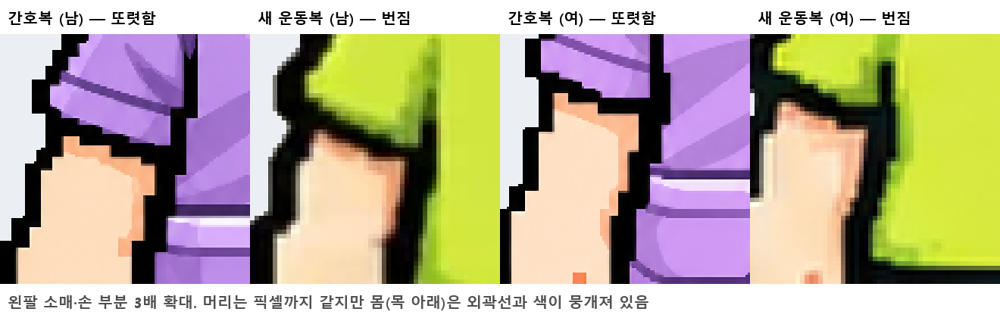

# 움트다 기본 운동복 수정 요청

2026-11-20 · 요청: TK

## 한 줄 요약

**몸(목 아래)만 간호복처럼 또렷하게 다시 그려 주세요.** 나머지는 다 좋습니다.

## ⚠️ 가장 중요한 것: 새로 만들지 말고, 보낸 파일을 고쳐 주세요

그림을 처음부터 다시 만들면 매번 얼굴이나 몸이 달라집니다. 이번에도 그랬습니다.

- 지난번에 보내 주신 `char-m-workout.png`, `char-f-workout.png`를 **열어서 그 파일 위에서** 고칩니다.
- **0~364행(얼굴)은 건드리지 않습니다.** 목 아래 픽셀만 손봅니다.
- AI로 새 그림을 다시 생성하지 않습니다. 도트 편집 도구(Aseprite, Piskel, 포토샵 연필 도구 등)로 직접 정리합니다.

## 잘 된 것 (그대로 두기)

- 얼굴(0~364행)이 기준 머리와 픽셀까지 같습니다.
- 크기, 위치, 발 높이가 간호복과 정확히 같습니다.
- 반투명 픽셀이 없고, 떠 있는 점도 없습니다.
- 옷 디자인(라임 반팔, 검은 바지, 흰 운동화)도 좋습니다.

## 고칠 것

목 아래 몸이 번져 있습니다. 외곽선과 색 경계가 뭉개져서, 또렷한 얼굴과 따로 놀아 보입니다.

- 이번 간호복(`look-top-nurse-m.png`, `look-top-nurse-f.png`)의 몸처럼 **도트가 또렷하게** 그려 주세요.
- 외곽선은 간호복과 같은 굵기의 검은 도트 선으로, 끊김이나 번짐 없이 그립니다.
- 색 경계도 계단처럼 또렷하게 나눕니다. 흐린 중간색으로 뭉개지 않습니다.
- 그림을 키우거나 줄이면서 생긴 번짐이라면, 512×768 크기에서 바로 도트로 다시 정리해 주세요.

얼굴, 크기, 위치, 옷 디자인은 바꾸지 않습니다.

## 보내기 전 확인

- [ ] 간호복과 나란히 놓고 3배로 키웠을 때, 몸의 선명도가 같은가
- [ ] 0~364행이 `head` 파일과 여전히 똑같은가
- [ ] 발바닥 마지막 줄이 y=755인가
- [ ] 반투명 픽셀과 떠 있는 점이 없는가
