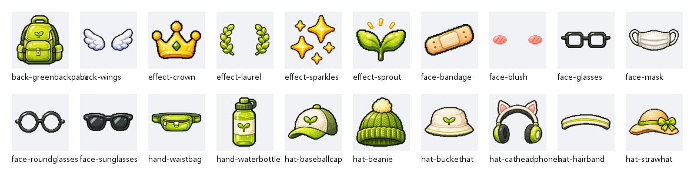
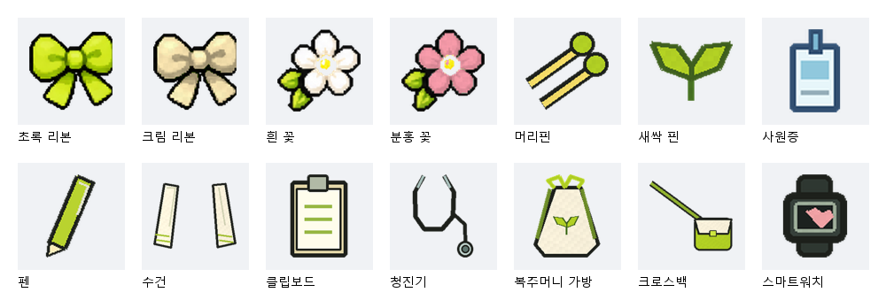

# 움트다 꾸미기 아이콘 14종 요청서

2026-11-20 · 요청: TK

## 한눈에 보기

이번에 보내 주신 꾸미기 아이콘 20장은 바로 앱에 넣었습니다. 아주 좋습니다.
**남은 14종도 같은 그림체로** 그려 주세요. 머리 장식 6종과 소품 8종입니다.

- 이번에도 아이콘만 그리면 됩니다. 캐릭터에 입힌 그림은 따로 정해서 다시 부탁드리겠습니다.
- 아이콘은 꾸미기 화면에서 아이템을 고르는 칸에 들어갑니다.

## 기준: 이번에 받은 20장

- 그림체, 굵은 검은 외곽선, 하이라이트, 라임·크림 색감을 이 20장과 같게 맞춰 주세요.
- 20장을 나란히 놓았을 때 한 세트로 보여야 합니다.

## 그릴 아이콘 14종

지금 앱에 들어 있는 옛 아이콘입니다. 무엇을 그릴지만 참고하시고, 그림은 새로 그려 주세요.

### 머리 장식 6종

| 파일 이름 | 이름 | 모습 |
| --- | --- | --- |
| `icon-hair-greenribbon.png` | 초록 리본 | 라임색 리본 |
| `icon-hair-creamribbon.png` | 크림 리본 | 크림색 리본. 초록 리본과 모양은 같고 색만 다르게 |
| `icon-hair-whiteflower.png` | 흰 꽃 | 흰 꽃잎, 노란 꽃술, 작은 잎 |
| `icon-hair-pinkflower.png` | 분홍 꽃 | 분홍 꽃잎. 흰 꽃과 모양은 같고 색만 다르게 |
| `icon-hair-hairpins.png` | 머리핀 | 라임색 구슬이 달린 실핀 2개 |
| `icon-hair-sproutclip.png` | 새싹 핀 | 새싹 모양 머리핀. 특별 아이템 '새싹'과 헷갈리지 않게 **핀이 보이도록** |

### 소품 8종

| 파일 이름 | 이름 | 모습 |
| --- | --- | --- |
| `icon-hand-idbadge.png` | 사원증 | 목걸이 줄이 달린 사원증 카드 |
| `icon-hand-pen.png` | 펜 | 라임색 펜 한 자루 |
| `icon-hand-towel.png` | 수건 | 접은 운동 수건(흰색이나 크림색, 라임 줄 포인트) |
| `icon-hand-clipboard.png` | 클립보드 | 집게와 종이가 있는 클립보드 |
| `icon-hand-stethoscope.png` | 청진기 | 청진기 전체(귀꽂이, 관, 동그란 판) |
| `icon-hand-drawstringbag.png` | 복주머니 가방 | 끈으로 조이는 주머니 가방, 새싹 무늬 |
| `icon-hand-crossbodybag.png` | 크로스백 | 끈이 달린 작은 라임색 가방 |
| `icon-hand-smartwatch.png` | 스마트워치 | 화면에 하트가 있는 스마트워치 |

지금 수건과 청진기 아이콘은 캐릭터 그림에서 잘라 낸 조각이라 알아보기 어렵습니다. **물건 전체가 보이게** 그려 주세요.

## 파일 규격 (이번 20장과 같게)

- 256×256 투명 PNG
- 사방에 16px 여백을 두고, 물건의 긴 쪽이 224px을 꽉 채우게 가운데 놓기
- 배경, 그림자, 후광 없음
- 파일 이름은 위 표 그대로

## 보내기 전 확인

- [ ] 14장 모두 이번 20장과 같은 그림체, 같은 외곽선 굵기인가
- [ ] 휴대폰 칸 크기(56×56)로 줄여도 무엇인지 바로 알아볼 수 있는가
- [ ] 초록·크림 리본, 흰·분홍 꽃이 색만 다른 한 쌍으로 보이는가
- [ ] 새싹 핀과 특별 아이템 '새싹'이 구분되는가
- [ ] 수건과 청진기가 물건 전체로 보이는가
- [ ] 34장(20장 + 14장)을 한눈에 보는 모음 그림 1장도 같이
