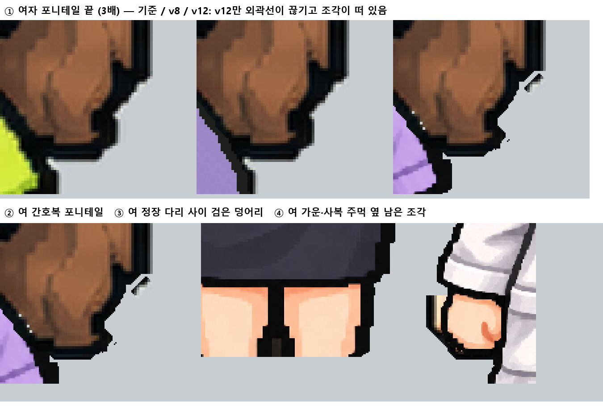

# 움트다 유니폼 v12 수정 요청

2026-11-20 · 요청: TK · 기준: `움트다-캐릭터-그림-기준서.md`

## 한눈에 보기

유니폼은 **v12 그림으로 갑니다.** 몸 그림은 v8보다 자연스러워서 좋습니다.
다만 깨진 곳이 있습니다. **아래만 고쳐서** 다시 보내 주세요. 디자인은 바꾸지 않습니다.

## 고칠 곳

| 번호 | 대상 | 문제 | 고칠 방법 |
| --- | --- | --- | --- |
| ① ② | 여자 유니폼 전부 | 포니테일 끝 외곽선이 끊기고, 옆에 작은 조각과 흰 점이 떠 있습니다. | 포니테일 끝은 기준 캐릭터(`char-f-workout.png`) 그대로 둡니다. 떠 있는 조각과 흰 점은 지웁니다. |
| ③ | 여자 정장 | 무릎 아래, 두 다리 사이에 검은 덩어리가 있습니다. | 다리 사이는 투명하게 비웁니다. |
| ④ | 여자 가운·사복 | 왼쪽 주먹 옆에 예전 팔의 조각이 남아 있습니다. | 남은 조각을 지웁니다. |

①~④ 말고도 같은 종류의 흠이 있으면 함께 고쳐 주세요. 무엇을 고쳤는지 표로 알려 주시면 됩니다.

## 이번에 보낼 유니폼

| 키 | 이름 | 비고 |
| --- | --- | --- |
| `nurse` | 간호복 | |
| `doctor` | 가운 | 파란 스크럽 위 흰 가운 |
| `office` | 정장 | |
| `scrub` | 스크럽 | 남: 네이비, 여: 분홍 |
| `worker` | 작업복 | v12 디자인 그대로 |
| `casualcoat` | 가운·사복 | ⏳ TK가 넣을지 정하는 중입니다. 고쳐서 같이 보내 주세요. |

다음 두 벌은 이번에 보내지 않습니다.

- `chef` 조리복: 당분간 뺍니다.
- `hoodie` 후드 집업: 유니폼이 아니라 옷으로 옮깁니다. 옷이므로 **사원증을 뺀** 그림이 필요합니다. 이번에 함께 보내 주셔도 됩니다.

## 지켜야 할 것 (기준서 요약)

- 머리 0~364행은 기준 캐릭터와 픽셀까지 같게 둡니다.
- 발바닥 마지막 줄은 y=755입니다.
- 512×768 투명 PNG로 보냅니다.
- 파일 이름은 `look-top-<키>-<m|f>.png`입니다. 분류 폴더 없이 한 폴더에 모아 보냅니다.
- 위 표에 없는 유니폼을 더하거나, 이름을 바꾸지 않습니다.

## 보내기 전 확인

- [ ] 2배로 키웠을 때 떠 있는 조각, 흰 점, 끊긴 외곽선이 없는가
- [ ] 여자 그림의 포니테일 끝이 기준 캐릭터와 같은가
- [ ] 머리 0~364행이 기준 캐릭터와 같고, 발바닥 마지막 줄이 y=755인가
- [ ] 모음 그림 1장과 고친 곳 표를 함께 보내는가
