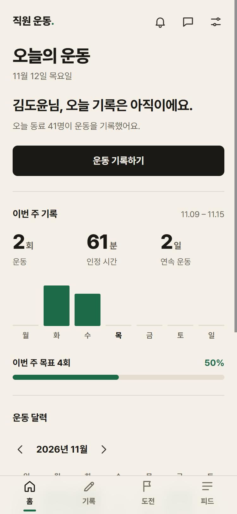
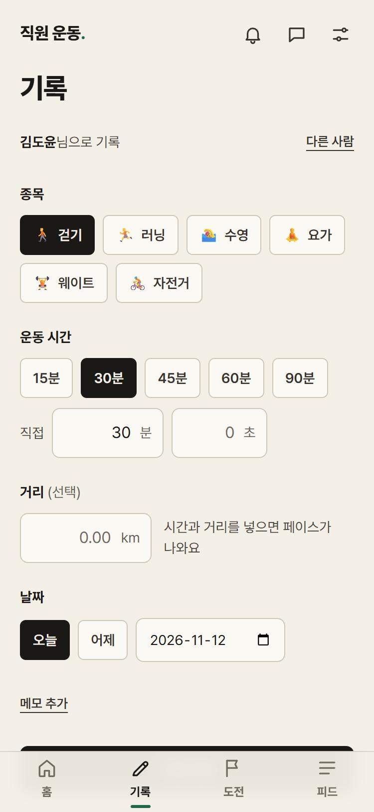
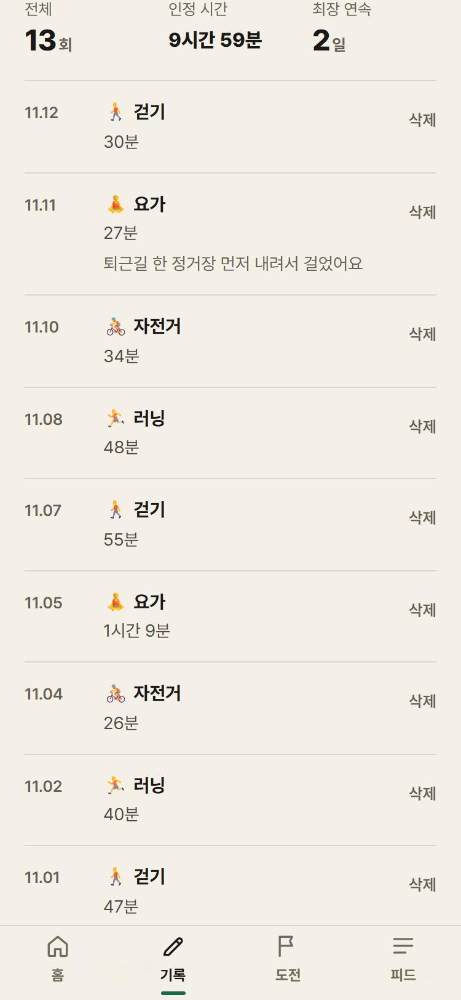
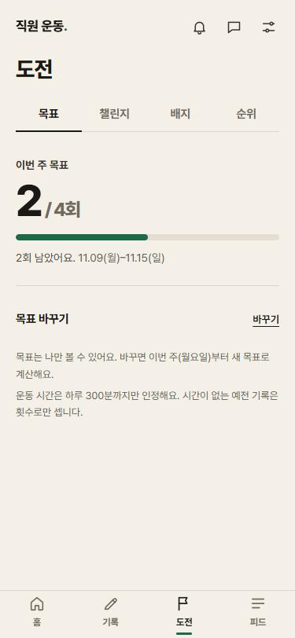
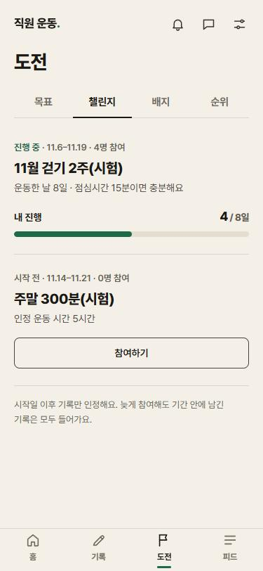
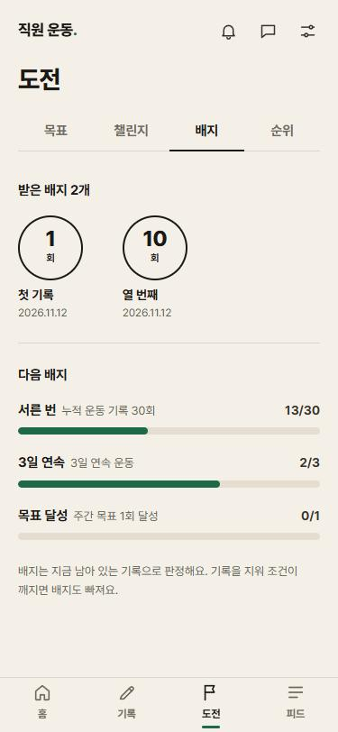
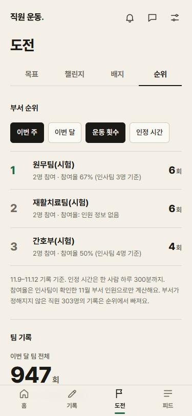
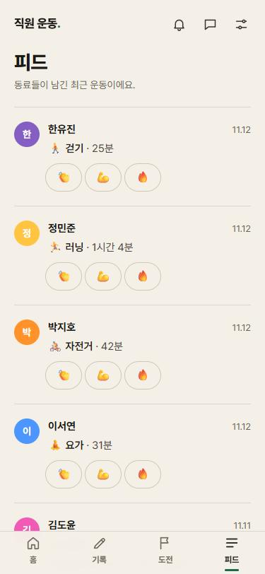
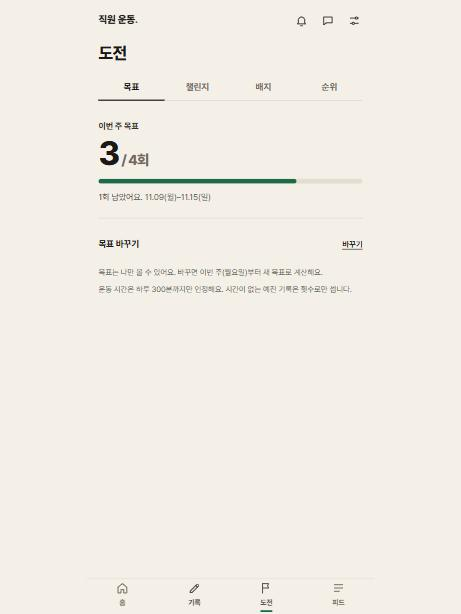

# 세계로병원 운동 관리 v2.1 최종 보고서

2026-11-12 · 운영 DB 변경·운영 배포 없음 · PM 최종 승인 대기

## 1. 구현 완료 기능

| 기능 | 내용 |
|---|---|
| 개인 운동 목표 | 주간 **운동 횟수** 또는 **운동 시간** 목표. 본인만 조회·변경. 바꾸면 이번 주(월요일)부터 적용, 지난 주는 그때 목표로 판정 |
| 챌린지 | 관리자가 기간·기준(운동 횟수/인정 시간/운동한 날)·목표 설정, 직원은 참여 버튼. 시작 전 기록 불인정, 늦게 참여해도 기간 내 기록 인정. 관리자 "지금 끝내기" |
| 배지 | 누적 기록(1·10·30·100회), 연속 운동(3·7·14·30일), 목표 달성(1·4·12주). 자동 지급, 중복 불가(DB 기본키), 기록 삭제로 조건이 깨지면 회수. 다음 배지 조건 표시 |
| 부서별 경쟁 | 부서별 참여 인원·운동 횟수·인정 운동 시간. 순위는 **횟수**와 **인정 시간** 따로. 참여율은 **관리자가 입력한 인사팀 확인 인원**(월별, 출처 필수)이 있을 때만 계산하고, 없으면 "인원 정보 없음" |
| 퇴사 처리 | 직원 삭제 대신 퇴사일 기록. 다음 날부터 로그인·기존 세션 차단, 기록·부서 이력 보존, 달력 분모에서 제외 |
| UI/UX 전면 개편 | 아이보리·차콜 + 포인트 색 1개(짙은 초록). 카드·그라데이션·그림자·메뉴 이모지 제거, 큰 숫자와 구분선 중심. 하단 메뉴 4개(홈·기록·도전·피드), 관리는 상단 버튼으로 분리. 기록 입력은 종목·시간 칩 2번 + 저장 |

공통 규칙: 진행률·순위는 저장하지 않고 운동 기록에서 계산합니다(기존 기록 재사용, 중복 저장 없음). 날짜는 한국 시간, 한 주는 월~일입니다. 인정 시간은 한 사람 하루 300분까지이고, 시간이 없는 과거 기록은 횟수·활동일로만 셉니다.

## 2. 화면 캡처 (휴대폰 375px)

| 홈 | 기록 | 내 기록 |
|---|---|---|
|  |  |  |

| 도전 · 목표 | 도전 · 챌린지 | 도전 · 배지 |
|---|---|---|
|  |  |  |

| 도전 · 순위 | 피드 | 태블릿(768px) |
|---|---|---|
|  |  |  |

캡처는 가상 직원 데이터(시험 DB)로 찍었고, 촬영 후 데이터를 지웠습니다. 관리 화면(부서·인원·챌린지·퇴사)은 시험용 관리자 비밀번호 화면 입력이 자동 승인되지 않아 캡처하지 못했습니다. 관리 기능은 API 자동 시험으로만 확인했습니다.

## 3. DB 마이그레이션

| 파일 | 내용 | 시험 DB |
|---|---|---|
| `024_v21_engagement.sql` | 새 테이블 7개(부서, 부서별 인사팀 인원, 직원 부서 이력, 개인 목표, 챌린지, 챌린지 참여, 배지) + `employees.left_at` 칸 1개 + 달력 분모에서 퇴사자 제외. 새 테이블은 RLS 켬·정책 없음·공개 권한 회수(서버만 접근). 기존 데이터 변경 없음 | 적용, 두 번 실행해도 같음, 되돌리기 SQL 포함 |

운영 실행 순서는 024 실행 뒤 배포입니다. 024 전에 배포하면 새 API가 없는 테이블을 찾습니다.

## 4. 시험 결과 (전부 통과, 실패 0)

| 시험 | 결과 | 증빙 |
|---|---|---|
| v2.1 기능 (목표 생성·수정·달성률, 챌린지 참여·진행·종료·경계일, 배지 지급·중복·회수, 부서 순위·참여율·이동 이력, 기록 수정·삭제 재계산, 과거 기록·300분 상한, 직원 간 접근 차단, 관리자 권한, 퇴사, 참여 1,200행) | **83/83** | `test-results/v21-test.txt` |
| 같은 시험을 운영 모드 서버(`next start`)에서 | **83/83** | `v21-test-prod-mode.txt` |
| 기존 회귀 (화면 읽기·건의·공지·종목·직원·감사 로그) | **28/28** (운영 모드도 28/28) | `v21-regression.txt` |
| 기존 보안 (PIN·관리자 인증·CSRF·요청 제한·직접 쓰기 차단) | **49/49** | `v21-security.txt` |
| 응원 중복 방지 | **22/22** | `v21-cheer.txt` |
| 달력 집계 (300명, 1,000건 초과) | 통과 | `v21-calendar.txt` |
| 공개 키 점검 (022·023 포함) | **29/29** | `v21-prodcheck-local.txt` |
| 백업→복원 왕복 (새 테이블 포함 16개) | 전부 일치 | 시험 DB |
| 운영 빌드 (`next build`) | 성공 | — |

## 5. 기존 기능 영향

| 기존 | v2.1 |
|---|---|
| 하단 메뉴 홈·통계·피드·기록 | 홈·기록·도전·피드 |
| 홈의 운동 기록 입력 | 기록 탭 맨 위 (홈에는 "운동 기록하기" 버튼) |
| 홈의 "이번 달 운동왕 TOP 3" | **없어짐**. 도전 > 순위의 개인 순위(최근 8주)로 대체 |
| 통계 탭 (팀 기록·하이라이트·신기록·요일·종목·랭킹) | 도전 > 순위 아래 "팀 기록"으로 이동, 내용 동일 |
| 기록 탭의 "다른 직원 검색해 기록 보기" | **제거**. 기록 탭은 내 기록만 보여주고, 동료 기록은 피드에서 봄 |
| 기록 입력의 시·분·초 칸 | 분 칩(15~90분) + 분 직접 입력. 초는 거리 종목에서만 |
| 직원 삭제 | 그대로 기록까지 삭제(안내 문구만 변경). 퇴사는 새 "퇴사" 기능 사용 |
| 화면 확대 금지 | 확대 허용(접근성) |
| 달력·피드·응원·PIN·관리자 인증 | 유지. 인증에는 "퇴사일 지난 직원 세션 거부" 한 가지만 추가 |

## 6. 남은 문제

- **부서·인원 자료가 아직 없습니다.** 운영 첫날에는 부서 순위가 비어 있고 참여율은 "인원 정보 없음"입니다. 관리자가 부서와 소속, 인사팀 인원(월별)을 입력해야 합니다.
- **퇴사일이 공개됩니다.** `employees`는 공개 키로 읽히는 테이블이라 `left_at`도 보입니다.
- **부서 참여율은 100%에서 자릅니다.** 인사팀 인원보다 참여자가 많은 불일치가 화면에서는 가려집니다.
- **주중 목표 변경:** 이번 주 목표를 주말에 낮추면 바로 달성으로 판정됩니다.
- **글꼴:** Pretendard를 외부 CDN에서 불러옵니다. 병원망과 카카오톡 인앱에서는 확인하지 못했습니다(실패하면 기본 글꼴로 보임).
- **접근성:** 터치 영역 44px 이상, 보조 글씨 명암비 4.6:1(아이보리 위 `#716A5E`), 포인트 색 5.8:1입니다. 계산한 조합만 적었고, 전 화면을 검사하지는 않았습니다.
- **관리 화면은 화면 확인 전**입니다(API 시험만 통과).
- **쓰지 않는 기존 파일:** 월 목표 테이블 `employee_goals`(운영 0건)와 `GoalProgress`·`StreakBadge`·`TopRankingBoard` 컴포넌트는 지우지 않고 남겼습니다.

## 7. 배포 대상 커밋

- 브랜치 `work/v2.1`, 최종 커밋 `92d9737` (화면·서버 코드 기준 `d7c6bef`)
- 운영 중인 v2.0(`cbffaba`) 위에 쌓은 브랜치입니다. 운영 반영 기록표 커밋은 `work/v2-pin`에만 있습니다.
- 운영 순서(승인 시): 운영 백업 → 024 실행 → 배포 → 점검 스크립트(`--after-lock --after-022 --after-023`) + v2.1 기능 확인 → 휴대폰 확인
